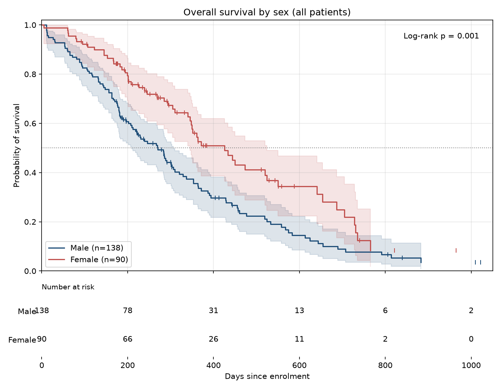

# Clinical Research Analysis

A learning project that answers a clinical research question the way a published study would: a written analysis plan first, then Kaplan-Meier curves, Cox regression, a small meta-analysis, and a paper-style report.

**Not clinical advice.** The dataset is a published teaching dataset.

## Research question

Is overall survival different between women and men with advanced lung cancer, and how is performance status related to survival?

## Data

NCCTG advanced lung cancer data (called `cancer` in the current version of the R `survival` package, and `lung` in older ones), 228 patients.
Loprinzi CL, et al. J Clin Oncol 1994;12(3):601-607.

## Status
- [x] Phase 1: Setup and statistical analysis plan
- [x] Phase 2: Data preparation and Table 1
- [x] Phase 3: Kaplan-Meier curves and log-rank test
- [x] Phase 4: Cox regression
- [ ] Phase 5: Meta-analysis
- [ ] Phase 6: Paper-style report

## How to run
1. `pip install -r requirements.txt`
2. `python get_data.py` downloads the data into `data/lung.csv`
3. `python prepare_data.py` checks the data, creates `data/analysis_data.csv` and builds Table 1
4. `python km_analysis.py` draws Kaplan-Meier curves and runs the log-rank tests
5. python cox_analysis.py ...
6. python ph_window_check.py ...

## Documents
- [Statistical analysis plan](docs/statistical_analysis_plan.md)

- [Table 1: baseline characteristics](docs/table1.md)

- [Kaplan-Meier results](docs/km_results.md)

- [docs/cox_results.md]

- [docs/ph_window_check.md]

## Kaplan-Meier results

Unadjusted comparison of overall survival by sex. Full tables and the exploratory performance status analysis are in [docs/km_results.md](docs/km_results.md).