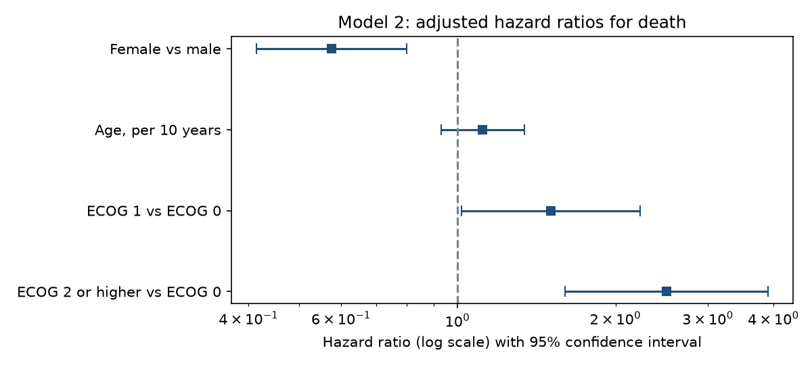
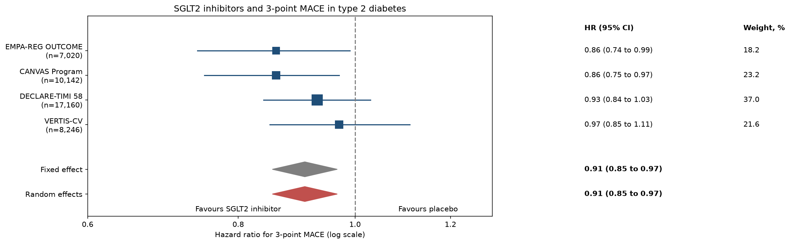

# Clinical Research Analysis

A learning project that answers a clinical research question the way a published study would: a written analysis plan first, then Kaplan-Meier curves, Cox regression, a small meta-analysis, and a paper-style report.

**Not clinical advice.** The dataset is a published teaching dataset.

## Research question

Is overall survival different between women and men with advanced lung cancer, and how is performance status related to survival?

## Data

NCCTG advanced lung cancer data (called `cancer` in the current version of the R `survival` package, and `lung` in older ones), 228 patients.
Loprinzi CL, et al. J Clin Oncol 1994;12(3):601-607.

## Status
- [x] Phase 1: Setup and statistical analysis plan
- [x] Phase 2: Data preparation and Table 1
- [x] Phase 3: Kaplan-Meier curves and log-rank test
- [x] Phase 4: Cox regression
- [x] Phase 5: Meta-analysis
- [ ] Phase 6: Paper-style report

## How to run
1. `pip install -r requirements.txt`
2. `python get_data.py` downloads the data into `data/lung.csv`
3. `python prepare_data.py` checks the data, creates `data/analysis_data.csv` and builds Table 1
4. `python km_analysis.py` draws Kaplan-Meier curves and runs the log-rank tests
5. `python cox_analysis.py` fits the Cox models and checks the proportional hazards assumption
6. `python ph_window_check.py` compares hazard ratios in early and late follow-up
7. `python meta_analysis.py` pools four published trials and draws a forest plot

## Documents
- [Statistical analysis plan](docs/statistical_analysis_plan.md)
- [Table 1: baseline characteristics](docs/table1.md)
- [Kaplan-Meier results](docs/km_results.md)
- [Cox regression results](docs/cox_results.md)
- [Time-window check of proportional hazards](docs/ph_window_check.md)
- [Meta-analysis plan](docs/meta_analysis_plan.md)
- [Meta-analysis results](docs/meta_results.md)

## Kaplan-Meier results

Unadjusted comparison of overall survival by sex. Full tables and the exploratory performance status analysis are in [docs/km_results.md](docs/km_results.md).

## Cox regression results

**Main finding.** Women had a lower rate of death than men: hazard ratio 0.59 (95% CI 0.42 to 0.82) unadjusted, and 0.58 (0.41 to 0.80) adjusted for age and performance status. Adjustment changed the estimate very little. A worse performance status was associated with a higher rate of death (ECOG 2 or higher vs 0: HR 2.50, 1.60 to 3.90). Age showed no clear association (HR 1.12 per 10 years, 0.93 to 1.34).

**Proportional hazards.** A residual-based check flagged sex and ECOG 2 or higher. A post-hoc comparison of early (up to day 300) and late follow-up found larger hazard ratios early than late for both (sex 0.47 vs 0.78; ECOG 2 or higher 3.87 vs 1.28), but the difference was clear only for ECOG 2 or higher (ratio 0.33, 95% CI 0.13 to 0.86, p = 0.024, not adjusted for multiple testing). The single hazard ratios are therefore best read as averages over follow-up, especially for ECOG.

**What this does not show.** These are associations in observational data and do not show that sex or performance status causes a difference in survival.

Details: [Cox results](docs/cox_results.md) and [time-window check](docs/ph_window_check.md).

## Meta-analysis

A small teaching meta-analysis of four cardiovascular outcome trials of SGLT2 inhibitors in type 2 diabetes (3-point MACE). Hazard ratios come from the primary publications. This is not a systematic review. See [docs/meta_results.md](docs/meta_results.md) for results and limits.