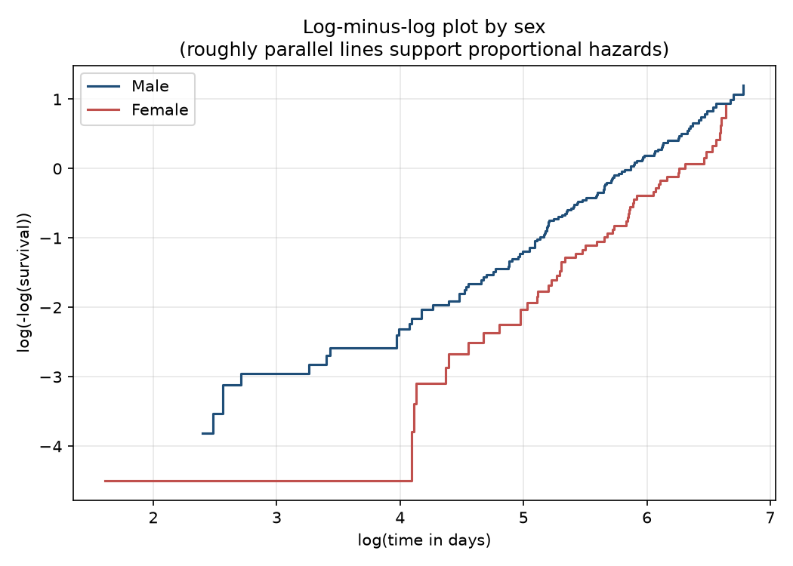

# Cox regression results

These results follow the [statistical analysis plan](statistical_analysis_plan.md). A hazard ratio (HR) compares the rate of death between groups at any point in time. An HR below 1 means a lower rate than the reference group, and above 1 means a higher rate.

## Primary analysis: sex

Unadjusted, women compared with men: hazard ratio 0.59 (95% CI 0.42 to 0.82, p = 0.001).

Adjusted for age and ECOG, women compared with men: hazard ratio 0.58 (95% CI 0.41 to 0.80, p = 0.001).

## All models

| Model | Variable | HR (95% CI) | p | Patients | Deaths |
|---|---|---|---|---|---|
| Model 1: sex only (all patients) | Female vs male | 0.59 (0.42 to 0.82) | 0.001 | 228 | 165 |
| Model 1 repeated on the complete cases | Female vs male | 0.59 (0.43 to 0.82) | 0.002 | 227 | 164 |
| Model 2: sex, age and ECOG (complete cases) | Female vs male | 0.58 (0.41 to 0.80) | 0.001 | 227 | 164 |
| Model 2: sex, age and ECOG (complete cases) | Age, per 10 years | 1.12 (0.93 to 1.34) | 0.235 | 227 | 164 |
| Model 2: sex, age and ECOG (complete cases) | ECOG 1 vs ECOG 0 | 1.51 (1.02 to 2.23) | 0.040 | 227 | 164 |
| Model 2: sex, age and ECOG (complete cases) | ECOG 2 or higher vs ECOG 0 | 2.50 (1.60 to 3.90) | <0.001 | 227 | 164 |
| Secondary: ECOG 2 or higher vs 0-1, unadjusted | ECOG 2 or higher vs ECOG 0-1 | 2.00 (1.41 to 2.82) | <0.001 | 227 | 164 |
| Secondary: ECOG 2 or higher vs 0-1, adjusted for sex and age | ECOG 2 or higher vs ECOG 0-1 | 1.91 (1.34 to 2.71) | <0.001 | 227 | 164 |
| Secondary: ECOG 2 or higher vs 0-1, adjusted for sex and age | Female vs male | 0.59 (0.43 to 0.82) | 0.002 | 227 | 164 |
| Secondary: ECOG 2 or higher vs 0-1, adjusted for sex and age | Age, per 10 years | 1.13 (0.94 to 1.35) | 0.207 | 227 | 164 |

Model 2 uses 227 patients, because one patient has no recorded ECOG score. ECOG 0 and male sex are the reference groups. Age is shown per 10 years.

## Checking the proportional hazards assumption

The Cox model assumes that hazard ratios stay roughly constant over time. Two checks were used: the correlation of Schoenfeld residuals with event time (an approximate check) and a log-minus-log plot.

| Variable | Correlation of residuals with time | p | Reading |
|---|---|---|---|
| Female vs male | -0.26 | <0.001 | possible violation |
| Age, per 10 years | -0.05 | 0.487 | no clear sign of a problem |
| ECOG 1 vs ECOG 0 | 0.13 | 0.096 | no clear sign of a problem |
| ECOG 2 or higher vs ECOG 0 | 0.27 | <0.001 | possible violation |

A p-value below 0.05 in the table would suggest that a hazard ratio changes over time. With only four covariates and a modest number of deaths, these checks cannot rule out smaller departures from the assumption.

## Limits

- The data are observational, so a hazard ratio shows an association and does not show that sex or performance status causes a difference in survival.
- Adjustment for age and ECOG reduces confounding but cannot remove it. Other factors, such as the treatments patients received, are not in the data.
- The ECOG analysis is exploratory, as stated in the plan. The primary question is the sex comparison only.
- The data are old, so results may not describe patients today.
