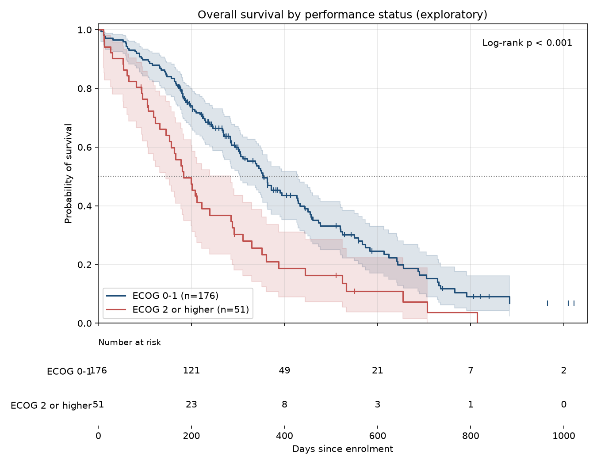

# Kaplan-Meier results

These results follow the [statistical analysis plan](statistical_analysis_plan.md). They are unadjusted: age and performance status are not yet taken into account (Phase 4).

## Primary analysis: overall survival by sex

All 228 patients.

| Group | Patients | Deaths | Censored | Median survival, days (95% CI) | Survival at 180 days (95% CI) | Survival at 365 days (95% CI) | Survival at 500 days (95% CI) |
|---|---|---|---|---|---|---|---|
| Male | 138 | 112 | 26 | 270 (210 to 306) | 64% (56% to 72%) | 34% (25% to 42%) | 22% (15% to 31%) |
| Female | 90 | 53 | 37 | 426 (345 to 524) | 84% (75% to 90%) | 53% (40% to 64%) | 41% (29% to 53%) |

Male: median survival 270 days (95% CI 210 to 306), 112 deaths among 138 patients; Female: median survival 426 days (95% CI 345 to 524), 53 deaths among 90 patients. Log-rank test: chi-square = 10.33 on 1 degree of freedom, p = 0.001.

## Secondary analysis (exploratory): overall survival by performance status

227 patients with a recorded ECOG score. ECOG 0-1 means fully active or walking about with symptoms. ECOG 2 or higher means in bed for part of the day or more.

| Group | Patients | Deaths | Censored | Median survival, days (95% CI) | Survival at 180 days (95% CI) | Survival at 365 days (95% CI) | Survival at 500 days (95% CI) |
|---|---|---|---|---|---|---|---|
| ECOG 0-1 | 176 | 119 | 57 | 353 (305 to 428) | 78% (71% to 84%) | 47% (39% to 55%) | 33% (25% to 42%) |
| ECOG 2 or higher | 51 | 45 | 6 | 183 (145 to 285) | 52% (37% to 64%) | 21% (11% to 34%) | 16% (7% to 28%) |

ECOG 0-1: median survival 353 days (95% CI 305 to 428), 119 deaths among 176 patients; ECOG 2 or higher: median survival 183 days (95% CI 145 to 285), 45 deaths among 51 patients. Log-rank test: chi-square = 15.96 on 1 degree of freedom, p < 0.001.

## How to read these results

- The curve shows the share of patients still alive over time. Small ticks mark patients who were censored (still alive or lost to follow-up at that time).
- Median survival is the time at which the curve crosses 50%. It is read from the curve, so it takes censoring into account.
- The shaded bands are 95% confidence intervals. They widen on the right, where few patients remain at risk.
- The log-rank test asks whether the curves differ more than chance would explain. A small p-value is not proof of cause, and a large one is not proof of no difference.

## Limits

- These are unadjusted comparisons. Men and women may differ in age or performance status, which could explain part of a difference. The adjusted Cox model in the next phase addresses this.
- The ECOG analysis is exploratory, as stated in the plan.
- The data are observational and old, so results may not describe patients today.
